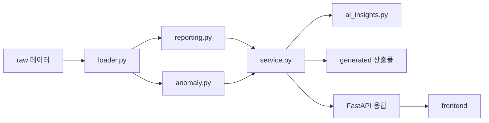
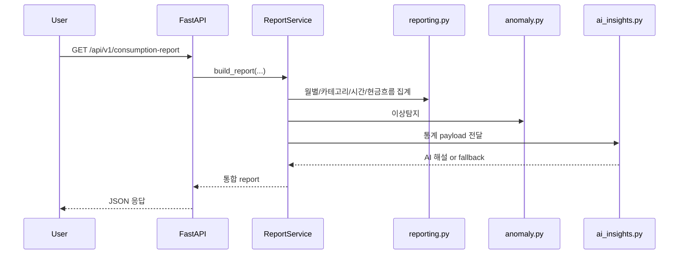
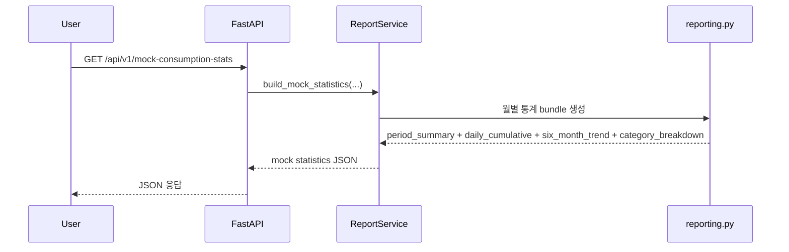

# Architecture

## 개요

이 프로젝트는 `원천 금융 데이터 -> 통계 집계 -> 이상탐지 -> LLM 해설 -> API/프론트 제공` 흐름으로 동작한다.

LLM이 raw 거래를 직접 계산하지 않는다. 숫자 정합성과 재현 가능성은 코드가 보장하고, LLM은 그 결과를 바탕으로 해설을 생성한다.

## 1. 전체 처리 흐름



## 2. 모듈별 역할

### `loader.py`

- CSV/JSON 파일 로드
- UTF-8 기준 파싱
- 필수 컬럼 검증

### `reporting.py`

- 월별 카드 소비 집계
- 카테고리별 소비 비중 계산
- 시간대/요일 패턴 계산
- 현금흐름 요약 계산
- 목업 기반 월간 통계 생성
  - 월 요약
  - 일별 누적 비교
  - 6개월 추이
  - 카테고리별 전월 비교

### `anomaly.py`

- 이상 거래 탐지
- 규칙 기반 점수 산정
- `risk_score`, `anomaly_type`, `reason` 생성

### `service.py`

- 전체 리포트 조립
- 사용자 선택
- 기간 선택
- LLM 호출용 payload 조립
- generated 파일 저장 orchestration

### `ai_insights.py`

- Gemini 호출
- 모델 fallback
- JSON-only 응답 파싱
- 실패 시 fallback analysis 반환

### `main.py`

- FastAPI 엔드포인트 정의
- 프론트 정적 파일 제공

## 3. 데이터 흐름 상세

### 3-1. 기본 소비 리포트



### 3-2. 목업 기반 월간 통계



## 4. generated 산출물 구조

### 기존 root 산출물

- `consumption_report_monthly.csv`
- `consumption_report_category.csv`
- `consumption_report_time.csv`
- `consumption_report_anomalies.csv`
- `cashflow_report_monthly.csv`
- `consumption_report_summary.json`

이 파일들은 기본 소비 리포트 구조를 빠르게 확인하기 위한 대표 산출물이다.

### 사용자별/월별 산출물

경로:

```text
data/generated/users/<user_id>/<month>/
```

예시:

```text
data/generated/users/U1001/2026-02/
├─ period_summary.json
├─ daily_cumulative.csv
├─ category_breakdown.csv
├─ six_month_trend.csv
└─ six_month_summary.json
```

## 5. LLM은 무엇을 입력으로 받는가

LLM은 raw 거래 전체를 그대로 받지 않는다.

현재 입력 payload:

- `overview`
- `monthly`
- `top_categories`
- `top_subcategories`
- `time_patterns`
- `cashflow`
- `anomalies`
- `fallback_analysis`

즉 현재 구조는:

```text
raw -> 코드 집계/탐지 -> 요약 payload -> LLM 해설
```

## 6. 왜 이런 구조를 썼는가

### 장점

- 숫자 정합성이 높다
- 테스트가 쉽다
- 재현 가능하다
- 프롬프트가 짧고 안정적이다

### 한계

- 사용자별 거래 맥락을 LLM이 깊게 못 본다
- 가맹점 수준의 서사 해설이 약할 수 있다
- 해설이 통계 중심으로 비슷해질 수 있다

## 7. 다음 확장 포인트

- representative raw samples를 LLM 입력에 추가
- merchant-level signal 생성
- 프론트에서 AI 분석과 월간 통계의 연결 강화
- generated root 파일도 사용자별로 분리하거나 manifest 기반으로 전환
