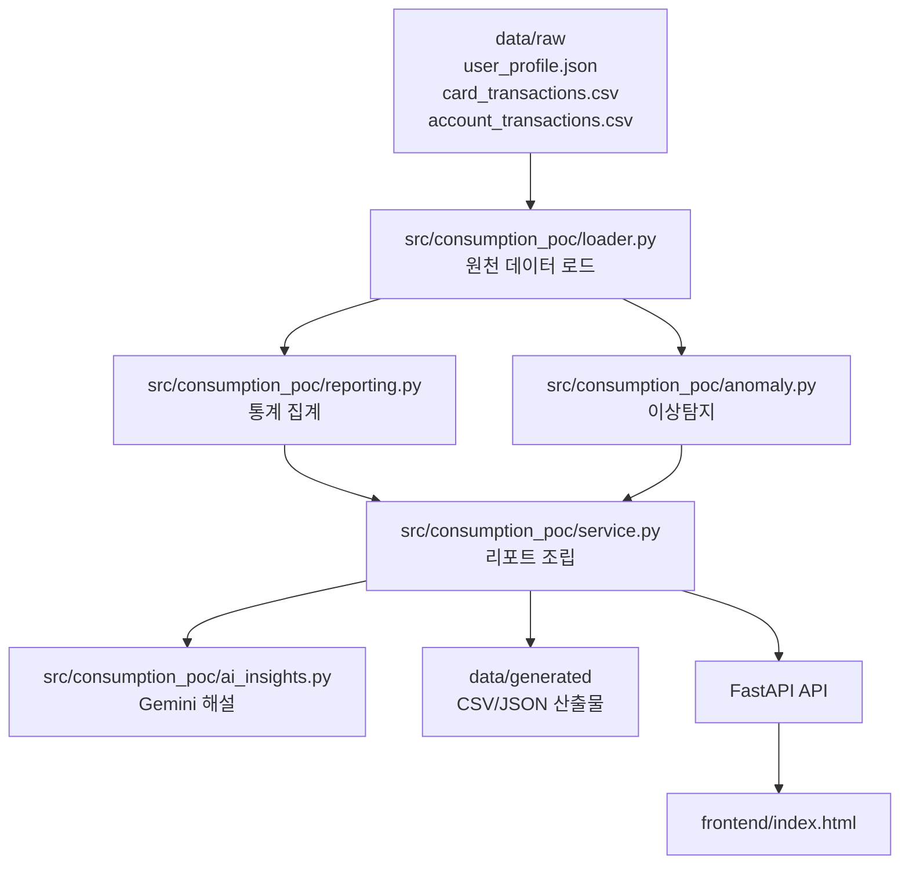

# AI Consumption Report POC

이 프로젝트는 금융 서비스의 `소비 리포트`와 `AI 소비 분석`을 빠르게 검증하기 위한 POC다.
핵심 목적은 다음 두 가지다.

- 원천 금융 데이터를 기반으로 사람이 읽을 수 있는 소비 통계를 만든다.
- 통계와 이상탐지 결과를 바탕으로 LLM이 해설을 생성한다.

이 문서는 처음 프로젝트를 보는 사람이 전체 구조를 5분 안에 이해할 수 있도록 작성했다.

## 1. 한눈에 보는 구조



## 2. 현재 구현 범위

- 사용자 수: 8명
- 기간: 2025-10 ~ 2026-03
- 원천 데이터:
  - 카드 결제 내역
  - 계좌 입출금 내역
  - 사용자 프로필
- 산출물:
  - 기본 소비 리포트
  - 월간 목업형 통계 리포트
  - 규칙 기반 이상탐지
  - LLM 소비 분석

## 3. 폴더 구조

```text
ai/
├─ data/
│  ├─ raw/                  # 사람이 관리하는 원천 mock 데이터
│  └─ generated/            # 코드가 생성하는 통계/리포트 산출물
├─ docs/                    # 프로젝트 문서
├─ frontend/
│  └─ index.html            # 단일 페이지 프론트
├─ scripts/
│  ├─ generate_mock_raw_data.py
│  └─ regenerate_reports.py
├─ src/consumption_poc/
│  ├─ loader.py
│  ├─ reporting.py
│  ├─ anomaly.py
│  ├─ ai_insights.py
│  ├─ service.py
│  └─ main.py
└─ tests/
```

## 4. 이 프로젝트에서 중요한 원칙

- `raw`는 입력 데이터다.
- `generated`는 항상 코드로 다시 만들 수 있어야 한다.
- 수치 계산은 Python 코드가 책임진다.
- LLM은 숫자를 계산하는 주체가 아니라, 계산 결과를 해설하는 주체다.
- 프론트는 API와 generated 산출물을 읽는 소비자다.

## 5. 문서 읽는 순서

1. [architecture.md](c:\Users\SSAFY\S14P21A605\ai\docs\architecture.md)
2. [data-contract.md](c:\Users\SSAFY\S14P21A605\ai\docs\data-contract.md)
3. [api-spec.md](c:\Users\SSAFY\S14P21A605\ai\docs\api-spec.md)
4. [onboarding.md](c:\Users\SSAFY\S14P21A605\ai\docs\onboarding.md)
5. [worklog.md](c:\Users\SSAFY\S14P21A605\ai\docs\worklog.md)

## 5-1. 처음 보는 사람을 위한 3단계 이해법

### 1단계. raw와 generated를 구분한다

- `data/raw`는 사람이 만든 입력 데이터다.
- `data/generated`는 코드를 돌려 만든 출력 데이터다.
- 이 프로젝트를 이해할 때 가장 먼저 해야 할 일은 "무엇이 입력이고 무엇이 결과인지" 구분하는 것이다.

### 2단계. 숫자는 코드가 만들고 문장은 AI가 만든다고 이해한다

- `reporting.py`와 `anomaly.py`가 숫자를 만든다.
- `ai_insights.py`가 그 숫자를 읽고 해설 문장을 만든다.
- 따라서 숫자가 이상하면 먼저 코드와 raw를 보고, 문장이 이상하면 LLM 입력 payload를 봐야 한다.

### 3단계. 프론트는 두 개의 API를 조합해서 본다

- 월간 화면형 통계: `/api/v1/mock-consumption-stats`
- 종합 리포트와 AI 해설: `/api/v1/consumption-report`
- 즉 화면은 단일 API 하나가 아니라, 통계 API와 AI API를 같이 사용한다.

## 5-2. 💬 AI 챗봇 해명 (Justification) 기능 안내

이 프로젝트에는 **사용자가 자신의 소비 내역에 대해 직접 변명하고 소명할 수 있는 대화형 AI 기능**이 포함되어 있습니다. 마크다운이나 코드를 전혀 모르는 분이라도 아래 흐름만 알면 쉽게 이해하실 수 있습니다!

### 🤔 왜 이 기능이 필요한가요?
보통 AI 리포트를 받아보면 "이번 달 지출이 너무 큽니다! 줄이세요!" 하고 따끔하게 혼내는 경우가 많습니다. 하지만 가끔은 억울할 때가 있죠.
- *"이 결제 내역은 내가 쏜 게 아니라, 친구들 몫까지 내가 대표로 긁고 나중에 N빵(더치페이)으로 돌려받을 돈이야!"*
- *"이번 달 지출액이 큰 이유는, 앞으로 1년 동안 들을 온라인 강의를 한 번에 일시불로 결제한 자기계발 목적이야!"*

이럴 때 억울함을 풀기 위해 AI에게 상황을 설명하는 기능입니다.

### 💡 어떻게 동작하나요?
1. **변명하기**: 브라우저 화면 우측 하단의 `💬 해명하기` 창을 열고, 자유롭게 채팅하듯 진짜 이유를 입력하세요.
2. **AI의 똑똑한 맥락 파악**: 이 챗봇은 단순히 정해진 단어(예: '정산')만 보고 판단하는 멍청한 챗봇이 아닙니다. **LLM(대규모 언어 모델)이 문맥 전체를 꼼꼼히 읽고 판단**합니다. 합리적인 소비인지, 아니면 그냥 과소비를 포장한 핑계인지 구별해 냅니다.
3. **리포트 실시간 맞춤 갱신**: AI 코치가 "아, 이런 사정이 있었군요! 합당합니다!"라고 고개를 끄덕이면(`is_valid: true`), **즉시 여러분의 소비 리포트를 그 변명에 맞춰서 다시 써줍니다.** 

이제 더 이상 나만의 특별한 사정을 무시당한 채 AI에게 혼나지 않아도 됩니다!

### 🔧 기술적인 작동 방식 한 줄 요약
사용자가 채팅을 치면 → `src/api/v1/routers/chat.py`와 `src/domain/chat/chat_agent.py`가 LLM으로 타당성을 검사하고 → 결과를 스프링 백엔드가 DB에 저장한 뒤 → 프론트엔드가 즉시 리포트 화면을 새로고침하여 갱신된 분석결과를 화면에 뿌려줍니다.

## 6. 빠른 실행

### raw 데이터 재생성

```bash
python scripts/generate_mock_raw_data.py
```

### generated 산출물 재생성

```bash
python scripts/regenerate_reports.py
```

### API 서버 실행

```bash
cd src
python -m uvicorn main:app --host 127.0.0.1 --port 8000
```

기존 명령인 `python -m uvicorn consumption_poc.main:app --host 127.0.0.1 --port 8000` 도
호환되지만, 현재 DB 연동 기준 실제 런타임 엔트리는 `src/main.py` 입니다.

### 테스트 실행

```bash
python -m pytest -q
```

## 7. 핵심 포인트

- `GET /api/v1/consumption-report`
  - 기존 종합 소비 리포트 + AI 해설
- `GET /api/v1/mock-consumption-stats`
  - 목업 화면에 맞춘 월간 통계
- `data/generated/users/<user_id>/<month>/...`
  - 사용자별 월간 목업 통계 산출물

## 8. 현재 상태

- raw 데이터 대량 생성 완료
- generated 산출물 사용자별/월별 생성 완료
- FastAPI 연동 완료
- 프론트 시각화 완료
- Playwright 수동 검증 완료
- pytest 통과 상태 유지

## 9. 문제를 볼 때 어디를 먼저 봐야 하는가

### 통계 숫자가 이상하다

1. `data/raw`의 입력값 확인
2. `src/consumption_poc/reporting.py` 집계 로직 확인
3. `data/generated` 산출물 확인
4. 프론트 렌더링 확인

### 이상탐지가 이상하다

1. `src/consumption_poc/anomaly.py` 규칙 확인
2. 거래 금액과 시간대가 raw에 어떻게 들어있는지 확인
3. `consumption_report_anomalies.csv` 확인

### AI 해설이 이상하다

1. `service.py`가 LLM에 넘기는 payload 확인
2. `ai_insights.py` 프롬프트와 모델 설정 확인
3. `llm_status`가 `ok`인지 `degraded`인지 확인
